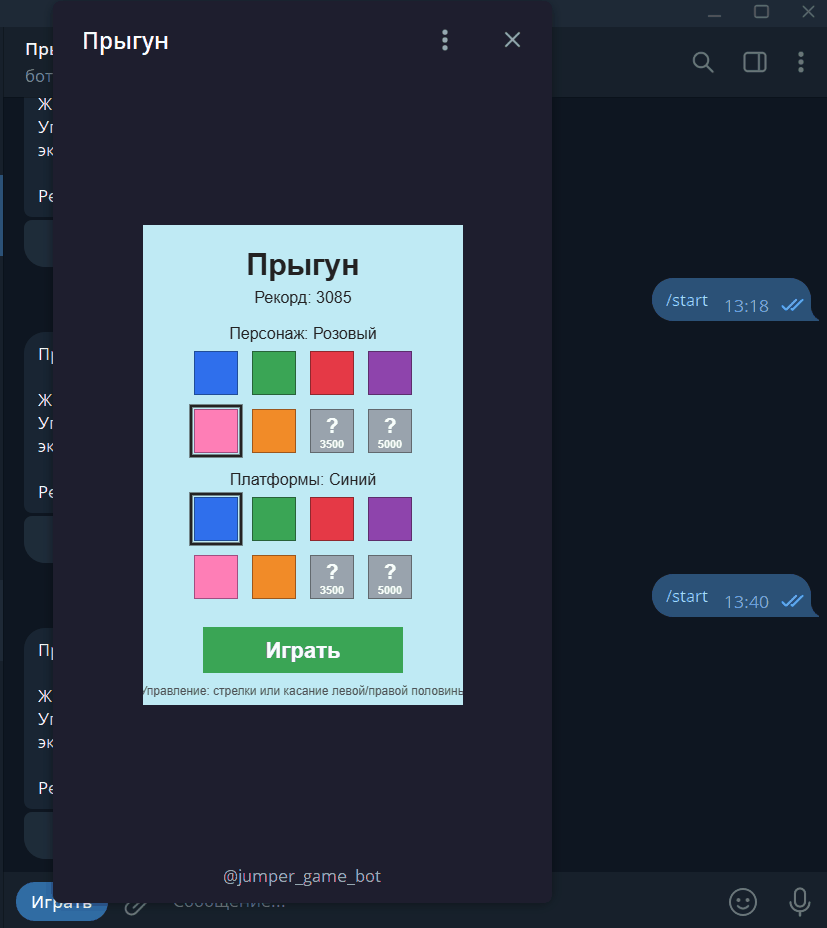

# 🟦 Прыгун — игра в стиле Doodle Jump

Браузерная аркада на чистом JavaScript и HTML5 Canvas: прыгайте по платформам, собирайте бонусы, сбивайте врагов и открывайте новые цвета за рекорды. Без библиотек и сборки — один файл `index.html`.

▶️ **[Играть в браузере](https://jeeas77.github.io/jumper-game/)**

🤖 **[Играть в Telegram — @jumper_game_bot](https://t.me/jumper_game_bot)**

<!-- Добавьте скриншот или GIF: положите файл в папку docs/ и раскомментируйте строку ниже -->

## Возможности

- **Бесконечная генерация платформ** и камера, следящая за игроком
- **Бонусы на платформах:**
  - 🔴 **Пружина** — сильный прыжок
  - 🚀 **Ракета** — несколько секунд полёта вверх, сбивает врагов
  - 🛡️ **Щит** — спасает один раз от врага или падения; при разрушении все враги на экране исчезают
- **Враги**, летающие по горизонтали: их можно победить прыжком сверху
- **Меню выбора цвета** персонажа и платформ (отдельно)
- **Закрытые цвета**, которые открываются по достижении рекорда
- **Сохранение** рекорда и выбранных цветов в браузере (`localStorage`)
- **Управление** с клавиатуры и касанием (работает на телефоне)
- **Запуск прямо в Telegram** через бота [@jumper_game_bot](https://t.me/jumper_game_bot)

## Управление

| Действие | Клавиатура | Касание |
|---|---|---|
| Влево / вправо | ← → или A / D | левая / правая половина экрана |
| Начать игру | Пробел или Enter | кнопка «Играть» |
| Вернуться в меню после проигрыша | Пробел | касание экрана |

## Цвета

Порядок цветов основан на опросе YouGov о любимых цветах в разных странах: синий оказался №1 во всех странах опроса, дальше чаще всего называли зелёный, красный и фиолетовый.

| Цвет | Открывается при рекорде |
|---|---|
| Синий, зелёный, красный | сразу |
| Фиолетовый | 500 |
| Розовый | 1000 |
| Оранжевый | 2000 |
| Жёлтый | 3500 |
| Чёрный | 5000 |

## Как это устроено

- **Игровой цикл с фиксированным шагом.** Логика работает с постоянной частотой (`TICKS_PER_SEC`), поэтому скорость игры одинакова на мониторах 60, 120 и 144 Гц.
- **Физика:** гравитация, прыжок, плавное горизонтальное ускорение; проверка приземления учитывает, что игрок пересёк платформу сверху.
- **Сущности:** игрок, платформы с бонусами (`item`), враги, щит. Столкновения — по прямоугольникам.
- **Состояния:** меню → игра → экран окончания → меню.
- Код разделён на блоки с комментариями: настройки, состояние, управление, обновление, отрисовка, цикл.

## Настройка баланса

Всё лежит в начале `index.html`:

| Параметр | Что меняет |
|---|---|
| `TICKS_PER_SEC` | общий темп игры |
| `SLOW` | множитель скоростей и гравитации |
| `SPEED`, `SMOOTH` | скорость и плавность движения влево-вправо |
| `SPRING_CHANCE`, `ROCKET_CHANCE`, `SHIELD_CHANCE` | как часто встречаются бонусы |
| `ENEMY_CHANCE`, `ENEMY_FROM` | частота врагов и счёт, с которого они появляются |
| `COLORS[].unlock` | порог рекорда для открытия цвета |

## Запуск локально

Скачайте репозиторий и откройте `index.html` в браузере. Установка не требуется.

## Технологии

HTML5 Canvas · JavaScript (ES6) · CSS · localStorage · Telegram Bot

## Планы

- Таблица лидеров и сохранение рекордов на сервере
- Таблица лидеров в Telegram-боте
- Звуки и новые типы врагов

---

Автор: Евгений · [GitHub](https://github.com/Jeeas77)
